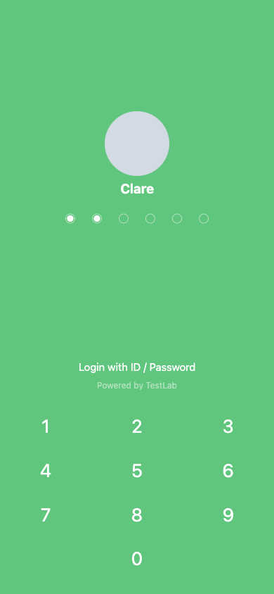
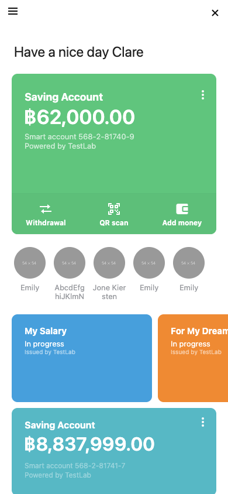

# Bank App

A take-home full-stack assignment: three pages of a mobile banking app (Splash, PIN, Main), run with one `docker compose` command.

The frontend is React 19 with TypeScript and Redux Toolkit, built with a hand-written webpack config and served by nginx. The backend is Go on the standard library `net/http` router, with three packages: the MySQL driver, bcrypt and JWT. The database is MySQL 8.4 with the provided schema and mock data (1 million users), plus one demo user, two small tables and a marker table added for this project.

| Assignment item | Status | Section |
|---|---|---|
| Routing for three pages | Done | [Assumptions](#assumptions) |
| Frontend build with a Dockerfile and webpack | Done | [Project structure](#project-structure) |
| Golang or Java Spring Boot | Done (Go) | [Project structure](#project-structure) |
| Use the provided SQL script and mock data | Done | [Quick start](#quick-start) |
| APIs for the three pages | Done | [API documentation](#api-documentation) |
| Unit tests (optional) | Done | [Tests](#tests) |
| Optimized service latency (optional) | Done | [Performance](#performance) |
| Optimized database schema (optional) | Done | [Performance](#performance) |
| Stress test report, e.g. locust or k6 (optional) | Not done | [Not included](#not-included) |
| docker-compose.yml for frontend, backend and database | Done | [Quick start](#quick-start) |

## Screenshots

Demo user `clare`, mobile screen size.

| Splash | PIN | Main |
|---|---|---|
|  |  |  |

## Quick start

Prerequisites: Docker Engine 25 or newer with Compose v2 (the db healthcheck uses `start_interval`), and about 8 GB of free disk (mock SQL 2.9 GB, MySQL data 3.9 GB, plus images).

Copy `mock.zip` into the repository root, then:

```sh
unzip mock.zip -d db/mock
cp .env.example .env
docker compose up -d --wait
```

The first start imports the mock data and builds the indexes. It took 177 seconds on an M1 Pro, not counting image pulls. The command returns when all three services are up.

Open http://localhost:8080.

| User ID | Data |
|---|---|
| `clare` | Demo user that matches the design: 5 accounts of every type, account flags, 3 debit cards, 6 recent transactions, a banner |
| `000018b0e1a211ef95a30242ac180002` | First user of the mock data: 3 saving accounts, 1 debit card |

The PIN is `135795` for every user.

On the first visit the PIN page opens a "Login with ID" dialog with `clare` filled in. To switch user, click "Login with ID / Password". Four wrong PINs lock the user for 60 seconds.

`docker compose down` stops the stack and keeps the data, so the next `up` is quick. `docker compose down -v` also deletes the database volume, and the next `up` imports everything again.

| Problem | Fix |
|---|---|
| `--wait` fails or never returns | Run `docker compose down -v`, then `docker compose up -d --wait`. Init files run only on an empty volume, and an init that stopped halfway never creates `init_done`. |
| The db container exits and `docker compose logs db` shows `Failed to open file '/mock/<name>.sql'` | A mock file is missing. The 12 `.sql` files must sit directly in `db/mock/`. Unzip again, then `down -v` and `up -d --wait`. |
| What is `init_done`? | An empty marker table created by the last init file. The db healthcheck waits for it, so the backend starts only after the import and the indexes are done. |

## Project structure

```
browser ── nginx :8080 ─┬─ /       static files (webpack build)
                        └─ /api/   Go :8080 ── MySQL :3306
```

Only port 8080 is published to the host. Go and MySQL are reachable only inside the compose network.

```
.
├── docker-compose.yml        db, backend and frontend services
├── .env.example              database credentials and JWT secret, copied to .env
├── backend/                  Go API
│   ├── main.go               config, DB pool, the 7 routes, HTTP server
│   ├── internal/config/      environment variables
│   ├── internal/httpx/       JSON and error responses, request log
│   ├── internal/auth/        profile, PIN check and lock, session cookie, auth middleware
│   ├── internal/home/        the 5 Main page endpoints, flag filter, card number masking
│   └── Dockerfile            golang:1.26 build, distroless runtime
├── frontend/                 React app
│   ├── public/index.html     HTML shell for the webpack build
│   ├── src/                  entry, routes, Redux store, API client
│   ├── src/splash/           Splash page
│   ├── src/pin/              PIN page, keypad, Login with ID dialog
│   ├── src/home/             Main page and its cards
│   ├── src/common/           loader used by Splash and Main
│   ├── src/assets/           template CSS (css/) and images (img/)
│   ├── webpack.config.js     production build and dev server
│   ├── nginx.conf            static files, /api/ proxy, fallback to index.html
│   └── Dockerfile            node:24-alpine build, nginx:1.30-alpine runtime
├── docs/screenshots/         the three screenshots above
├── db/
│   ├── init/                 runs once on an empty volume, in file-name order
│   └── mock/                 unzip mock.zip here (not in git)
└── scripts/                  bench.sh, explain.sql, drop-indexes.sql (see Performance)
```

`db/init/` is mounted as `/docker-entrypoint-initdb.d`:

| File | Purpose |
|---|---|
| `00-schema.sql` | The assignment's schema, unchanged |
| `10-load-mock.sql` | `SOURCE` of the 12 mock files from `db/mock/` |
| `20-account-names.sql` | New table `account_names` (display name per account) |
| `30-clare.sql` | Demo user `clare` in every table |
| `40-user-pins.sql` | New table `user_pins`: PIN hash, failed attempts, lock time, one row per user |
| `50-indexes.sql` | The 5 indexes |
| `99-init-done.sql` | Marker table `init_done` for the healthcheck |

The order matters. Clare must exist before `user_pins` is filled from `users`, and the indexes are built after all data is loaded.

## API documentation

All paths are under http://localhost:8080. Bodies are JSON.

| Method | Path | Session cookie | Used by |
|---|---|---|---|
| GET | `/api/auth/profile?userId={id}` | No | Splash, PIN |
| POST | `/api/auth/pin` | No (sets it) | PIN |
| GET | `/api/user` | Yes | Main |
| GET | `/api/accounts` | Yes | Main |
| GET | `/api/transactions/recent` | Yes | Main |
| GET | `/api/debit-cards` | Yes | Main |
| GET | `/api/banners` | Yes | Main |

Every error from these 7 endpoints has the same shape. Some codes add fields next to `code` and `message`:

```json
{"error":{"code":"PIN_LOCKED","message":"Too many attempts","retryAfterSec":60}}
```

Session: a correct PIN sets the cookie `session`. It holds a JWT signed with HS256 (claims `sub` = user ID, and `exp`) and lasts 15 minutes. Attributes are `HttpOnly`, `SameSite=Strict`, `Path=/`, `Max-Age=900`. There is no refresh. `Secure` is off in compose because the app runs on plain http://localhost; `COOKIE_SECURE=true` turns it on.

The five Main endpoints share these errors:

| Status | Code | When |
|---|---|---|
| 401 | `UNAUTHENTICATED` | Cookie missing, expired or tampered with |
| 500 | `INTERNAL_ERROR` | Any unexpected failure. Details go to the server log only. |

A NULL column is left out of the JSON. The examples below are real responses for `clare`, shortened.

```
GET /api/auth/profile?userId=clare

200  {"name":"Clare"}
404  {"error":{"code":"USER_NOT_FOUND","message":"User not found"}}
```

User IDs are case-insensitive, so `Clare` works too.

```
POST /api/auth/pin
{"userId":"clare","pin":"135795"}

204  no body
     Set-Cookie: session=<jwt>; Path=/; Max-Age=900; HttpOnly; SameSite=Strict
400  {"error":{"code":"VALIDATION_ERROR","message":"PIN must be 6 digits"}}
401  {"error":{"attemptsLeft":3,"code":"PIN_INVALID","message":"Invalid PIN"}}
429  {"error":{"code":"PIN_LOCKED","message":"Too many attempts","retryAfterSec":60}}
     Retry-After: 60
404  {"error":{"code":"USER_NOT_FOUND","message":"User not found"}}
```

A PIN that is not 6 digits gets 400 and is not counted. Wrong PINs get 401 with `attemptsLeft` 3, 2, 1. The 4th wrong PIN, and every PIN during the lock (correct or not), gets 429.

```
GET /api/user
200  {"name":"Clare","greetingMessage":"Have a nice day Clare"}

GET /api/accounts
200  [{"type":"saving-account","amount":62000.00,"currency":"THB","accountNumber":"568-2-81740-9",
       "issuer":"TestLab","color":"#24c875","isMainAccount":true},
      {"type":"goal-saving-account","amount":30000.00,"currency":"THB","accountNumber":"568-2-81743-3",
       "issuer":"TestLab","name":"Travel New York","progress":24,"color":"#9366ed","isMainAccount":false},
      {"type":"credit-loan","amount":30000.00,"currency":"THB","accountNumber":"568-2-81744-1",
       "issuer":"TestLab","name":"Need to repay","flags":["Disbursement","Overdue"],"color":"#557bf2",
       "isMainAccount":false}]

GET /api/transactions/recent
200  [{"name":"Emily","image":"https://dummyimage.com/54x54/999/fff","isBank":false},
      {"name":"AbcdEfghiJKlmN","image":"https://dummyimage.com/54x54/999/fff","isBank":true}]

GET /api/debit-cards
200  [{"name":"My Salary","status":"in-progress","issuer":"TestLab","color":"#00a1e2"},
      {"name":"My Debit card","status":"Active","issuer":"TestLab","color":"#ffffff",
       "borderColor":"#f2f3f7","number":"9440 78•• •••• 3115"}]

GET /api/banners
200  [{"title":"Want some money?","description":"You can start apply 'Clare'",
       "image":"https://dummyimage.com/54x54/999/fff"}]
```

Accounts: Clare has 5, 3 are shown. `name` is sent only when the account has one. `progress` is sent only for `goal-saving-account`. `flags` is sent only for `credit-loan`, and only `Disbursement` and `Overdue`.

Recent transactions: highest `transaction_id` first, at most 10. Clare has 6.

Debit cards: `number` is masked by the server. The first 6 and last 4 digits stay and the spacing is kept. A number with 10 digits or fewer keeps only the last 4. A card still in progress has no number.

To try it with curl, run these lines one by one. The second line should print `204`.

```sh
curl -s 'http://localhost:8080/api/auth/profile?userId=clare'
curl -s -c cookies.txt -o /dev/null -w '%{http_code}\n' -X POST http://localhost:8080/api/auth/pin -H 'Content-Type: application/json' -d '{"userId":"clare","pin":"135795"}'
curl -s -b cookies.txt http://localhost:8080/api/user
curl -s -b cookies.txt http://localhost:8080/api/accounts
curl -s -b cookies.txt http://localhost:8080/api/transactions/recent
curl -s -b cookies.txt http://localhost:8080/api/debit-cards
curl -s -b cookies.txt http://localhost:8080/api/banners
```

## Performance

The original schema has primary keys only, so every lookup by user was a full table scan. `db/init/50-indexes.sql` adds 5 indexes: `accounts(user_id)`, `account_flags(account_id)`, `transactions(user_id)`, `debit_cards(user_id)`, `banners(user_id)`. No table, column or row of the original schema is changed. The indexes are built after the mock import, because loading into indexed tables is slower.

| Endpoint | Rows read, before → after | Median ms, before → after | p95 ms, before → after |
|---|---|---|---|
| `/api/user` (control, primary key) | 1 → 1 | 1.7 → 1.7 | 1.8 → 1.9 |
| `/api/accounts` | 2,974,397 / 5,805,304 → 5 / 2 | 6278.7 → 3.0 | 6547.5 → 4.7 |
| `/api/transactions/recent` | 964,319 → 6 | 318.8 → 3.6 | 342.1 → 5.2 |
| `/api/debit-cards` | 967,710 → 3 | 177.8 → 3.8 | 213.3 → 4.8 |
| `/api/banners` | 963,048 → 1 | 371.1 → 3.5 | 384.4 → 5.0 |

Rows are the `EXPLAIN` estimate for the `WHERE` lookup. For accounts the two numbers are `accounts / account_flags`. The flags lookup runs once per account (Clare has 5), which made accounts the slowest endpoint.

Measured on an Apple M1 Pro (8 cores, 16 GB RAM), Docker 27.5.1 (VM with 8 CPUs, about 7.65 GiB), MySQL 8.4. Logged in as `clare`, one request at a time through http://localhost:8080. Each endpoint gets 3 warm-up requests, then 20 measured ones. Median of 20; p95 is the 19th of 20. The "before" numbers come from dropping the indexes on the running database, not from a fresh init.

To measure again (after, drop indexes, before, restore indexes):

```sh
./scripts/bench.sh
docker compose exec -T db sh -c 'MYSQL_PWD="$MYSQL_PASSWORD" mysql -u"$MYSQL_USER"' < scripts/drop-indexes.sql
./scripts/bench.sh
docker compose exec -T db sh -c 'MYSQL_PWD="$MYSQL_PASSWORD" mysql -u"$MYSQL_USER"' < db/init/50-indexes.sql
```

The "before" run takes about 3 minutes. Restoring the indexes takes about 20 seconds. `bench.sh` needs bash, curl, sort and awk; on Windows use Git Bash or WSL. It stops with a message when a request does not return 200, for example while Clare is PIN-locked.

## Tests

```sh
docker run --rm -v "$PWD/backend:/src" -w /src golang:1.26 go test ./...   # no local Go needed
cd backend && go test ./...                                                  # with Go 1.26
```


## Development

```sh
# Frontend dev server on http://localhost:3000 (Node 22.22 or newer), proxies /api to http://localhost:8080 (keep compose running)
cd frontend && npm install && npm start
# Rebuild the backend after a Go change
docker compose up -d --build backend
# MySQL shell
docker compose exec db sh -c 'MYSQL_PWD="$MYSQL_PASSWORD" mysql -u"$MYSQL_USER" assignment'
# bcrypt hash (cost 10) for a new PIN (htpasswd ships with macOS; on Linux install apache2-utils); put it in db/init/40-user-pins.sql, then down -v and up again
htpasswd -bnBC 10 "" <PIN> | tr -d ':\n'
```

## Assumptions

Decisions the assignment left open, grouped by area.

| Data | Reason |
|---|---|
| Added a demo user `clare` in `db/init/30-clare.sql` | Every mock user has the same shape (3 saving accounts, 1 card), so goal and loan cards, flags and the white card would never appear. The mock rows are not changed. |
| Clare's rows follow the design image and template HTML, her debit cards follow the frontend `api-specs`, and her account numbers are all different | The sources disagree in places. The template's 4th card is a copy of the 3rd, and the design shows one account number on every card as a placeholder. |
| Clare's IDs are readable (`clare`, `clare-acc-1`, `clare-card-1`, `clare-txn-01`) and sort in design order | Accounts and cards are returned `ORDER BY` ID, since MySQL guarantees no order without it. |
| New table `account_names(account_id, name)` with a foreign key to `accounts`. An account without a name shows its type: Saving Account, Credit Loan or Goal Saving Account | The template's "Edit Name and Color" menu shows the name is set by the user, but the schema has no column for it. Only Clare's accounts have names. |
| Recent transactions are the user's rows ordered by `transaction_id`, highest first, at most 10 | The schema has no time column, so true recency is not possible. |
| Clare's credit loan of `฿300.100` in the template is stored as `300.10` | The template has a typo; `api-specs.md` shows 300.10. |
| Greeting, banner, transaction names and account numbers are shown as stored | Mock values like `Hello User_…` and `Transaction_135017` are the data. No account number format is defined. |
| Development uses the full mock data, with no smaller dataset | A small dataset would hide what a reviewer meets (missing indexes, healthcheck timing). MySQL runs init files only on an empty volume, so the 3-minute import is paid only after a change in `db/init/`. |

| Auth and PIN | Reason |
|---|---|
| The user is identified by user ID only, entered in a dialog opened from "Login with ID / Password" on the PIN page | The mock data has no credentials. The assignment asks for three pages, so there is no extra login page. |
| The user ID is kept in `localStorage`, so the next visit goes straight to the PIN page | The ID is not a secret. The secret is the session cookie. |
| `GET /api/auth/profile` needs no login and returns the name only | The PIN page shows the name before login, like a banking app that remembers the device. Anyone who knows an ID can see the name. The lock state is not exposed. The PIN page photo is a grey placeholder, so nothing depends on an outside image. |
| One PIN, `135795`, for every user | The mock data has no PINs, and a reviewer needs one to pass the PIN page. |
| PINs are stored as bcrypt hashes (cost 10) in a new table `user_pins` with a foreign key to `users`. Only Go checks the PIN | No plain PIN is stored and the original tables stay unchanged. Cost 12 would not help: a 6-digit PIN has 1 million values, so a leaked hash falls at either cost (about 18 hours vs 3 days per core). The lock is what stops guessing. |
| 4 attempts, then a 60-second lock. Both are configurable (`PIN_MAX_ATTEMPTS`, `PIN_LOCK_SECONDS`) | The template's first error says "You have 3 attempts left". The lock is short so a reviewer can test it. |
| A correct PIN resets the counter. During the lock even the correct PIN is refused. After the lock the user gets 4 new attempts | The counter is reset on the next attempt after the lock ends, so there is no background job and no attempts log. |
| A locked user is refused before the bcrypt check. Otherwise the counter is updated in a transaction with `SELECT … FOR UPDATE`, after the bcrypt check | Locked users cost no bcrypt CPU. Without the row lock, parallel requests read the same counter and each gets a free guess. Checking bcrypt first keeps the row locked for milliseconds. It stays correct with several Go instances. |
| Go passes the current time into queries (UTC, whole seconds), stored as `datetime` | One clock for every request, and tests can use a fake time. `timestamp` would convert by connection time zone. |
| The session is a JWT in an `HttpOnly`, `SameSite=Strict` cookie | JavaScript cannot read it, so an XSS bug cannot steal it. The page and the API share one origin, so `Strict` needs no extra setup. |
| 15-minute session with no refresh token. A 401 on the Main page goes back to the PIN page | The user ID is still remembered, so only the PIN is asked again. |
| PIN messages: "You have N attempt(s) left" and "Try again in N second(s)" with a live countdown | The server sends numbers (`attemptsLeft`, `retryAfterSec`). The page builds the text and gets singular and plural right. |

| API | Reason |
|---|---|
| The five Main endpoints follow `api-specs.md` from the frontend assignment, with two changes: `/api/accounts` adds an optional `name`, `/api/debit-cards` sends a masked `number` | The full-stack resources define no API, so that file is the contract. |
| The API sends data; the frontend picks the card layout | Go keeps the data rules: flag filtering and card masking. |
| Only `Disbursement` and `Overdue` flags are sent, and only for `credit-loan` | The other mock flags (Flag3, Flag4, Flag5) are treated as internal. |
| `progress` is sent only for `goal-saving-account` | The mock has progress values on saving accounts that mean nothing. |
| Card numbers are masked in Go: first 6 and last 4 digits, spacing kept. Numbers with 10 digits or fewer keep only the last 4 | The full number never leaves the server. The mock has 103 short cards with irregular spacing, where the 6 + 4 rule would hide nothing. |
| Amounts are sent as JSON numbers straight from `DECIMAL` via `json.Number` | No float rounding. The page formats `฿62,000.00` from `currency`. |
| NULL columns are left out of the JSON | Cards in progress have no number, so the field is absent rather than `null`. |
| Errors use one shape, `{"error":{"code","message",…}}`. A 500 hides details | The page reacts to `code` and the extra fields. Internal errors are logged on the server only. |

| Frontend | Reason |
|---|---|
| Hand-written `webpack.config.js`, not create-react-app | create-react-app was deprecated in February 2025. |
| TypeScript 6 with `ts-loader`, not TypeScript 7 | TypeScript 7 is the Go rewrite and has no compiler API, so `ts-loader` cannot use it. With TS 6 one tool transpiles and type-checks, and a type error fails the build. |
| `style-loader` in both modes. No linter beyond `strict: true`. No polyfills | A single-page app shows nothing before JavaScript runs, so there is no unstyled flash to avoid. Modern browsers only. |
| Redux Toolkit: one slice `identity` (`userId`, `userNotFound`), server data in RTK Query, page-only state in components | The frontend assignment asks for TypeScript and prefers Redux. Only state shared by several pages goes in the store. RTK Query ships with Redux Toolkit. |
| The Main endpoints refetch every time the page opens | They take no user ID (the cookie identifies the user), so the cache key is the same for everyone. After a user switch, the next user could see the previous user's data. |
| react-router 8 with `BrowserRouter`: `/`, `/pin`, `/main`; anything else goes to `/`. Every navigation replaces the history entry | nginx and the dev server fall back to `index.html`. Back on the Main page leaves the app instead of returning to the PIN page. |
| The Splash page shows only at `/` and loads the profile, for at least 1 second | It does real work rather than a fixed delay, but the profile answers in milliseconds and the page would flash. |
| A stored user ID that the profile no longer finds (404) is cleared, and the dialog opens with "User not found." and cannot be closed | The ID came from this browser's storage; only the user can give a new one. |
| The Main page has no client-side guard | JavaScript cannot read an `HttpOnly` cookie. A 401 from the API sends the user to the PIN page. |
| The PIN is sent automatically at 6 digits and the keypad is disabled while waiting. Keyboard 0-9 and Backspace work | The template keypad has no submit button. The delete key stays from the template, although the design image does not show it. |
| The PIN error or lock message replaces the name | The template positions that message over the name. |
| A failed PIN request (500, network, timeout) is never re-sent automatically | A timeout may mean Go already counted the attempt. Re-sending would count it twice. |
| Every request times out after 10 seconds | Same as Go's write timeout. Without it the page would wait for nginx's 60 seconds. |
| One message, "Something went wrong. Please try again.", for 500, network errors, timeouts, a 502 from nginx, and any status without its own handling (such as 400) | The user's next step is the same in every case. On the PIN page the retry is a refresh or the dialog's Confirm. A failed dialog request keeps the dialog open with the typed ID. |
| If any Main endpoint fails, the whole page shows one error box with "Try again" | A bank page with missing cards suggests missing accounts, and the template has no per-section error style. "Try again" refetches only the failed endpoints. |
| If the profile fails on the Splash page, the app still goes to the PIN page and keeps the user ID | The user probably exists and the network failed. The PIN page loads the profile again. |
| The identity dialog is a native `<dialog>` with `showModal()`. It cannot be closed while no user ID is set | Backdrop, focus and Escape come from the browser. |
| The template stylesheet sits in `src/assets/css` next to `src/assets/img`, changed in 3 places: two `bg_profile.png` backgrounds and the `.rctly__thumb.is-bank` rule are removed | The template's `url(../img/…)` paths keep working. The removed images were not supplied, and css-loader fails the build on a missing `url()`. The grey background stays as the placeholder. |
| A picture that fails to load is hidden, leaving the grey circle | The image URLs point to an external site. |
| The "Make your Debit Card" block is left out | Every user has a card, and its image was not supplied. |
| The main account is the large card and is not repeated in the small list. A small card's corner depends on its type: saving shows Add money, a credit loan with an Overdue flag shows Pay, other credit loans show Disburse, a goal shows its progress ring | This follows the template and the design image. |
| Card colours come from the data as inline styles, not the template's colour classes. A white card (`#ffffff`) gets the template's grey text | Mock accounts are all green; Clare's colours match the design. White is the only light card colour in the data, so text colour is not computed from brightness. |
| The debit card strip width is computed from the card count | The template hard-codes `1595px`. |
| An `Active` card shows its number. Other statuses show text (`in-progress` shows "In progress") | Cards in progress have no number. |
| The template CSS shows at most 7 recent items | Items 8 to 10 of "at most 10" are never visible. |
| The corner buttons on small account cards are invisible | The template has no CSS for them, which matches the design image. |

| Infra | Reason |
|---|---|
| Go standard library `net/http` router with three packages: `go-sql-driver/mysql`, `x/crypto/bcrypt`, `golang-jwt/jwt/v5`. No Gin or Fiber | The assignment names the language only. Since Go 1.22 the router matches method and path. |
| Go packages by feature (`auth`, `home`), each with `handler.go`, `store.go` (SQL) and `rules.go` (pure rules) | A change to the PIN rules stays in one folder. Seven endpoints do not need handler, service and repository layers. `home` is the Main page, since a package cannot be named `main`. |
| Unit tests only for functions that do not touch the database, with no mocks or interfaces: PIN format, attempt counting, lock and reset, retry-after rounding, flag filtering, card number masking, account and card JSON shaping, config loading, and the error body | SQL is checked by running it against the real database. JWT handling is the library's own code; the middleware was checked on the running stack. |
| nginx serves the build and proxies `/api/` to Go | One origin: no CORS, and no API URL baked into the build. The dev server proxy does the same. |
| Required environment: `DB_*`, `JWT_SECRET`. Defaults in Go: `PORT` 8080, `COOKIE_SECURE` false, `SESSION_TTL_SECONDS` 900, `PIN_MAX_ATTEMPTS` 4, `PIN_LOCK_SECONDS` 60 | A missing required value stops the server with the variable's name. A bad optional value falls back to its default. The DSN is built in code with `parseTime` and UTC, so those cannot be mistyped. |
| Default connection pool. Fixed server timeouts: 5 s read header, 10 s read, 10 s write, 60 s idle. One `log/slog` line per request | The latency gain comes from the indexes, not pool tuning. |
| No graceful shutdown | Not asked for. The PIN transaction rolls back if the server stops mid-request. |
| MySQL 8.4 with `--skip-log-bin` | The binary log would write about 3 GB more during the import. |
| The backend connects as `MYSQL_USER`, which only has rights on `assignment` | Root is for administration only. Each service gets only the variables it uses. A required variable missing from `.env` makes `docker compose` stop and name it. |
| The mock is loaded with SQL `SOURCE` lines, not a shell script | On a Docker Desktop bind mount the image's entrypoint executes `.sh` init files instead of sourcing them. A missing file stops the init with its name. |
| The db healthcheck waits for `init_done` over TCP, with a 15-minute start period | The temporary init server listens only on the socket. The long start period allows for slow machines and does not slow down fast ones. |
| Images: a static Go binary (`CGO_ENABLED=0`) on distroless `nonroot`; the frontend built on `node:24-alpine` and served by `nginx:1.30-alpine` | The MySQL driver is pure Go, so the runtime needs no C library or shell. Only built files reach the final images. |
| `.gitattributes` keeps `*.sh` with LF line endings | `bench.sh` fails in Git Bash with CRLF line endings from a Windows checkout. |

## Not included

| Item | Reason |
|---|---|
| Stress test (k6) | Optional, not done. Latency is measured one request at a time instead (see Performance). |
| Refresh token and logout | The session lasts 15 minutes, then the PIN is asked again. The design has no logout control. |
| Increasing PIN lock time | The lock is 60 seconds every time so a reviewer can test it. A real system should lengthen it after each lock. |
| Per-user salt | Every user shares one bcrypt hash of the same PIN. Generating 1 million hashes takes about 18 hours. A real system has each user's own PIN and salt. |
| Swagger or OpenAPI UI | Seven endpoints with real examples fit in this README. |
| Pages behind buttons that lead nowhere | The assignment asks for three pages. ☰, ✕, Withdrawal, QR scan, Add money, Disburse, Pay, recent items, See all, the banner, Total Balance and the ⋮ menu items render as in the template and do nothing. |
| Frontend tests | The optional unit tests cover the backend rules. |
